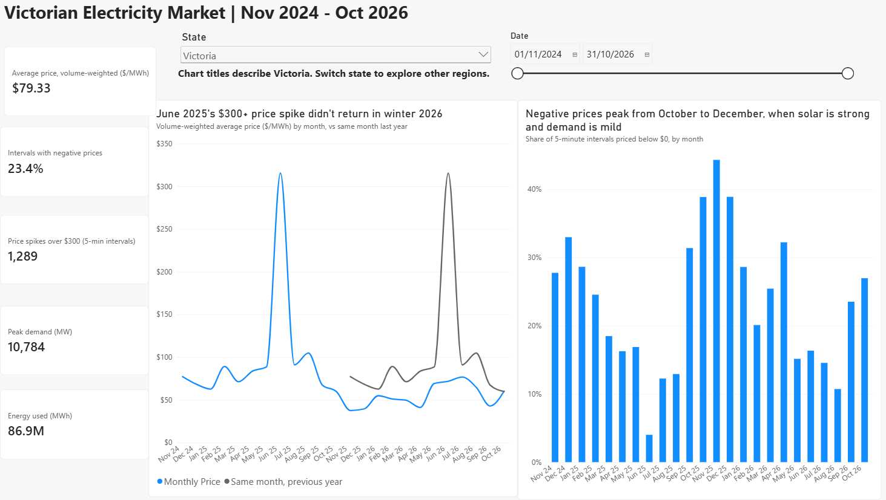
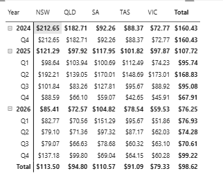
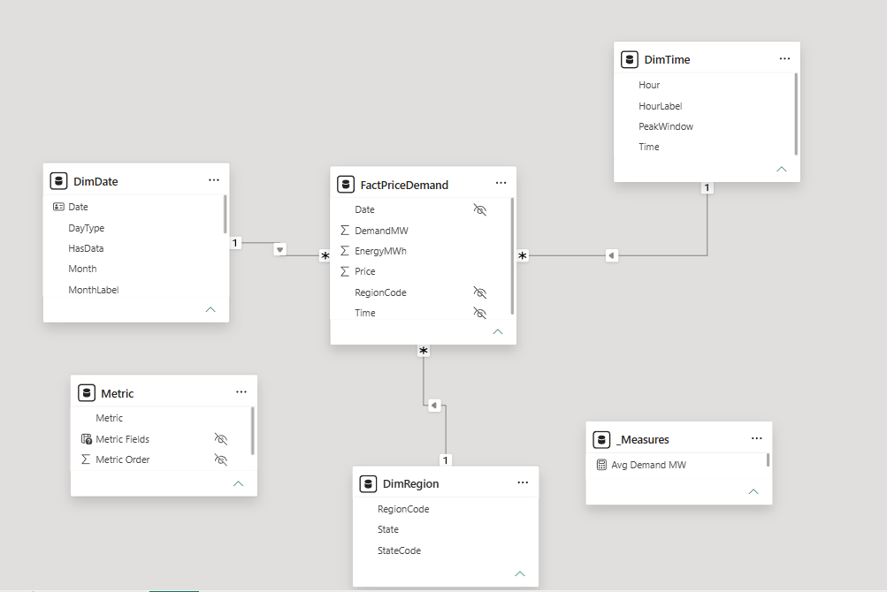
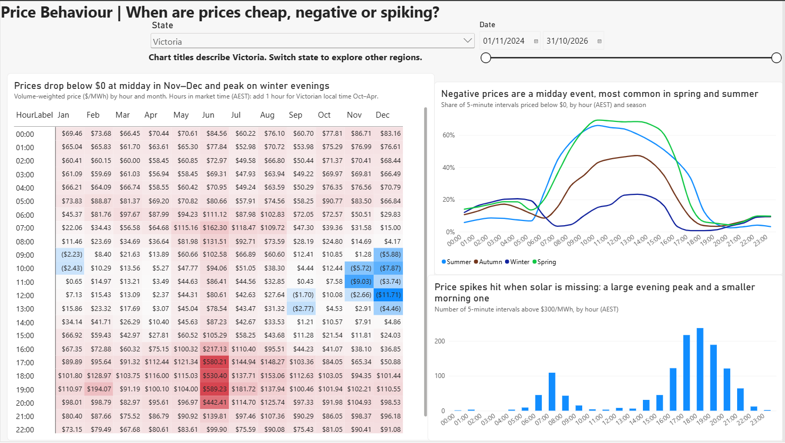
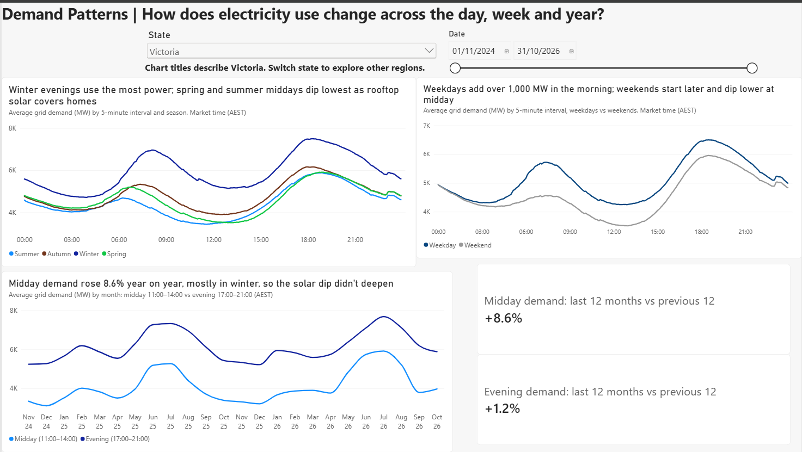
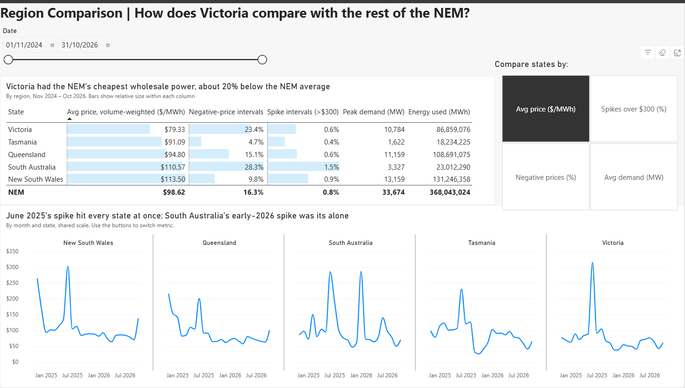
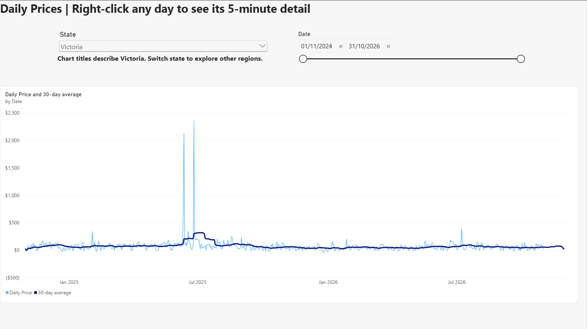
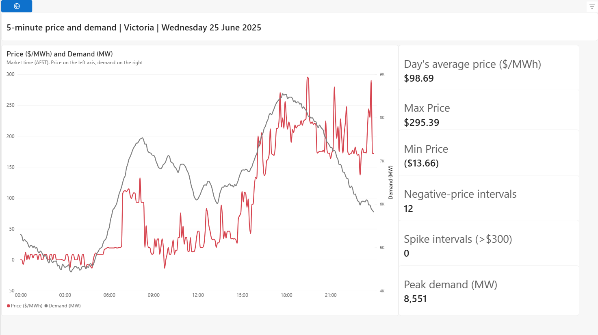
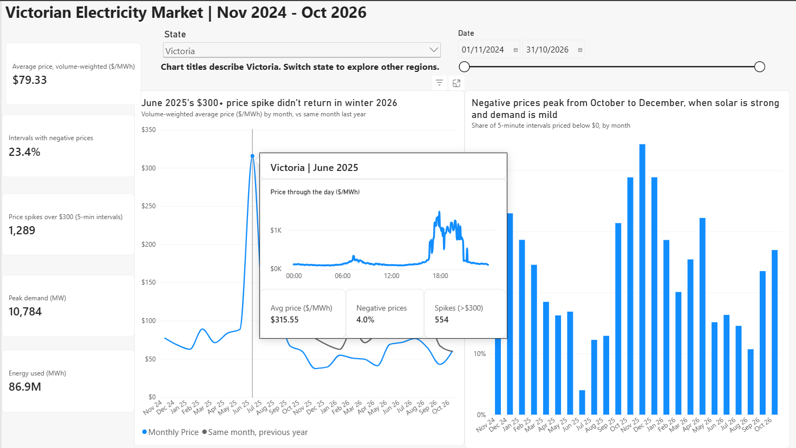

# Victorian Electricity Market Analysis (Power BI)

An interactive Power BI report on wholesale electricity prices and demand in Australia's National Electricity Market (NEM), focused on Victoria and compared with the other four regions. It covers 1,051,200 five-minute intervals from November 2024 to October 2026, pulled directly from AEMO.

**[View the live report](https://app.powerbi.com/view?r=eyJrIjoiOGRmMjAwZDAtZTczZS00YmMzLWI2ZjgtYWMyMTdkMzQ4MjdhIiwidCI6ImRmN2Y3NTc5LTNlOWMtNGE3ZS1iODQ0LTQyMDI4MGY1Mzg1OSIsImMiOjEwfQ%3D%3D)** (no sign-in needed)



---

## Business questions

1. How have wholesale prices and demand changed, and how does Victoria compare with the other NEM regions?
2. When do price spikes and negative prices happen, by time of day and season?
3. Is midday grid demand falling over time as rooftop solar grows?

## Key findings

**Victoria had the cheapest wholesale power in the NEM.** Its volume-weighted average price (VWAP) was $79.33/MWh, about 20% below the NEM average of $98.62. New South Wales was the most expensive region at $113.50.

| Region | VWAP ($/MWh) | Negative-price intervals | Spike intervals (>$300) | Peak demand (MW) |
|---|---|---|---|---|
| Victoria | $79.33 | 23.4% | 0.6% | 10,784 |
| Tasmania | $91.09 | 4.7% | 0.4% | 1,622 |
| Queensland | $94.80 | 15.1% | 0.6% | 11,159 |
| South Australia | $110.57 | 28.3% | 1.5% | 3,327 |
| New South Wales | $113.50 | 9.8% | 0.9% | 13,159 |
| **NEM** | **$98.62** | **16.3%** | **0.8%** | **33,674** |

**June 2025 was a NEM-wide price event, and it didn't repeat in 2026.** Every region spiked in June 2025, and Victoria's monthly VWAP went above $300/MWh. Victoria's Q2 average fell from $173 in 2025 to $62 in 2026.

**Negative prices are mostly a midday solar event.** In Victoria they are most common between 10:00 and 13:00 (AEST) from October to December. On spring and summer middays, around two-thirds of intervals are negative. Prices also go negative overnight in 10–20% of intervals, even in winter, which points to wind rather than solar.

**Price spikes happen when solar output is low.** The main peak is 17:00–19:00 (AEST), with a smaller one around 07:00. The evening ramp, as solar fades and demand rises, is when the grid is most exposed.

**Negative prices alone don't make power cheap.** South Australia had the most negative-price intervals (28.3%) but also the most spikes (1.5%), so its average price ($110.57) was among the highest.

**Spike days are driven by supply, not demand.** On 11 June 2025, Victoria's price peaked at $10,486/MWh and the day averaged $702.74, almost 9 times the two-year average. Demand peaked at only 7,816 MW, about 72% of Victoria's highest demand in the period. Extreme prices at moderate demand suggest a supply shortfall rather than a demand surge.

**Midday demand did not fall. It rose.** Comparing the last 12 months (Nov 2025 – Oct 2026) with the previous 12, Victoria's midday demand (11:00–14:00) rose 8.6%, while evening demand (17:00–21:00) rose only 1.2%. Most of the increase was in winter. Possible drivers include a colder or cloudier winter, electrification (heat pumps, EVs) and battery charging. Testing these needs weather and generation data (see Next steps).

**Demand patterns:** winter evenings use the most power (around 7,500 MW on average at 6pm), while spring and summer middays dip to about 3,500 MW, the "duck curve". Weekday mornings run about 1,100 MW higher than weekend mornings.

---

## Data validation

I checked the numbers at each stage rather than trusting the pipeline.

- **Completeness:** 120 files loaded (5 regions × 24 months) giving exactly 1,051,200 rows (730 days × 288 intervals × 5 regions). Each region has 210,240 intervals.
- **Quality:** 0% errors and 0% empty values in every column, profiled on the full dataset.
- **Timestamp shift:** AEMO timestamps mark the end of each interval. After shifting back 5 minutes, a two-month test load contained no 1 January 2025 dates, confirming that intervals land in the correct day and month.
- **Against an official source:** my VWAP matches the AER's published quarterly figures. 33 of 35 region-quarters are within 5%, and all are within 10%.

Victoria, mine vs the AER:

| Quarter | Mine | AER | Difference |
|---|---|---|---|
| Q1 2025 | $74.23 | $72 | +3.1% |
| Q2 2025 | $173.01 | $168 | +3.0% |
| Q3 2025 | $88.92 | $86 | +3.4% |
| Q4 2025 | $45.90 | $44 | +4.3% |
| Q1 2026 | $51.86 | $50 | +3.7% |
| Q2 2026 | $62.03 | $60 | +3.4% |
| Q3 2026 | $63.10 | $61 | +3.4% |

My figures are consistently slightly higher. That points to a difference in method, not an error: the AER weights prices by native demand, which includes non-scheduled generation (much of it midday solar), while AEMO's TOTALDEMAND column leaves it out. So low-priced midday intervals carry slightly less weight in my calculation. Tasmania, with very little solar, matches within 2%. South Australia, with the most solar, shows the largest gap.

The validation matrix in Power BI (quarterly VWAP by region), compared against the AER file:



---

## How it's built

### Data pipeline (Power Query)

- **Loaded straight from AEMO.** A custom function (`fnGetPriceDemand`) downloads one region-month CSV, and a query loops it over every month and region. `StartMonth` and `EndMonth` parameters control the date range. I built on two months for speed and switched to 24 at the end.
- **Refresh-friendly.** `Web.Contents` uses a fixed base URL with `RelativePath`, so the dataset can be refreshed in Power BI Service without a gateway.
- **Cleaning steps:**
  - set data types with an explicit locale
  - shifted timestamps from interval-end to interval-start
  - split the timestamp into separate date and time keys
  - added `EnergyMWh = DemandMW × 5/60`
  - removed unused columns

### Data model



A star schema with one fact table and three dimensions, all one-to-many with single-direction filtering:

| Table | Grain | Built with | Notes |
|---|---|---|---|
| FactPriceDemand | 5-minute interval × region | Power Query | 1,051,200 rows |
| DimDate | Day | DAX | Full calendar years; southern-hemisphere seasons; weekday/weekend; `HasData` flag |
| DimTime | 5-minute slot (288) | Power Query | Hour, hour label, NEM peak-hours flag (7am–10pm) |
| DimRegion | Region (5) | Power Query | Maps codes like VIC1 to state names |

Other design choices:

- **Date and time are stored as separate keys** instead of one datetime. About 730 dates and 288 times compress far better than 210,000 unique timestamps.
- **DimTime is built in Power Query, not DAX,** so its time values exactly match the fact table's and the relationship never drops rows.
- **Fact-table keys are hidden,** so report filters always go through the dimensions.
- **Auto date/time is turned off,** because the model has its own date table.

### DAX measures

All measures live in a dedicated measures table, organised in display folders (Base, Weighted Price, Price Events, Time Intelligence). Highlights:

**Volume-weighted average price:** iterates price × energy row by row with SUMX.

```dax
Wholesale Cost = SUMX ( FactPriceDemand, FactPriceDemand[Price] * FactPriceDemand[EnergyMWh] )
VWAP = DIVIDE ( [Wholesale Cost], [Total Energy MWh] )
```

**Coincident peak demand:** adds up the selected regions at each interval before taking the maximum, so the NEM total (33,674 MW) is correct rather than the sum of the five regional peaks (about 40,000 MW).

```dax
Peak Demand MW =
MAXX (
    SUMMARIZE ( FactPriceDemand, FactPriceDemand[Date], FactPriceDemand[Time] ),
    CALCULATE ( SUM ( FactPriceDemand[DemandMW] ) )
)
```

**Last 12 months vs previous 12:** anchored to the latest data date, so the comparison is always two full, equal-length years.

```dax
Midday Demand Change 12M =
VAR MaxDataDate = CALCULATE ( MAX ( FactPriceDemand[Date] ), REMOVEFILTERS ( DimDate ) )
VAR Last12 = CALCULATE ( [Midday Demand MW], DATESINPERIOD ( DimDate[Date], MaxDataDate, -12, MONTH ) )
VAR Prior12 = CALCULATE ( [Midday Demand MW], DATESINPERIOD ( DimDate[Date], EDATE ( MaxDataDate, -12 ), -12, MONTH ) )
RETURN
    DIVIDE ( Last12 - Prior12, Prior12 )
```

Other techniques used:

- CALCULATE with filter arguments (negative-price and spike counts)
- time intelligence (DATEADD, SAMEPERIODLASTYEAR, a rolling 30-day average with DATESINPERIOD)
- blank handling with COALESCE, so a day with no spikes shows 0 but a period with no data stays blank
- dynamic text measures for titles

### Report

| Page | What it shows |
|---|---|
| Overview | KPI cards, monthly VWAP vs same month last year, negative-price share by month |
| Price Behaviour | Hour × month price heatmap; negative prices by hour and season; spikes by hour |
| Demand Patterns | Daily demand curves by season; weekday vs weekend; midday vs evening demand trend |
| Region Comparison | Regional scorecard; monthly trends as small multiples, with a metric selector |
| Daily Prices | Daily VWAP with a 30-day rolling average |
| Day Detail (drill-through) | 5-minute price and demand for any single day |

**Price Behaviour:** when prices go negative and when they spike, by hour and month.



**Demand Patterns:** daily demand curves by season, weekday vs weekend, and the midday vs evening demand trend.



**Region Comparison:** Victoria against the other four regions, with buttons to switch the metric.



**Daily Prices:** daily price with a 30-day rolling average. Right-click any day to drill through.



**Interactivity:**

- slicers synced across pages
- right-click drill-through from any day to its 5-minute detail
- a report-page tooltip showing each month's daily price shape on hover
- a field parameter that switches the Region Comparison chart between price, negative prices, spikes and demand, with a title that changes to match

**Drill-through to a single day:** Victoria on 11 June 2025, when the price peaked at $10,486/MWh.



**Tooltip on hover:** each month's daily price shape and key numbers.



### Design decisions

- **Chart titles state the finding** (for example "June 2025's $300+ price spike didn't return in winter 2026"), and subtitles say what is measured.
- **No year-on-year KPI card on the Overview.** The data starts in November 2024, so across the full range the prior-year window would be half empty and the card would mislead. Year-on-year comparisons are shown month by month instead, where they're like-for-like.
- **VWAP rather than a simple average** as the headline price, because it reflects what energy actually cost. The simple average understates it, because cheap midday intervals have low demand.
- **$300/MWh spike threshold:** the strike price of standard cap contracts, where high prices start to matter commercially.
- **A heatmap colour scale centred on $0,** so negative prices read blue and expensive intervals red.
- **All times are AEMO market time (AEST).** Victorian clocks are one hour ahead from October to April, and this is noted on the relevant charts.

---

## Limitations

- **Demand weighting:** I weight by AEMO's TOTALDEMAND, not the AER's native demand (see Data validation).
- **Two years of data:** enough for seasonal patterns, but too short to call long-term trends. June averages are dominated by the June 2025 event.
- **Victoria-focused titles:** chart titles describe Victoria. Other regions can be explored with the State slicer, but the titles don't change.
- **No explanatory data yet:** without weather or generation-mix data, causes such as wind-driven negative prices or supply-driven spikes are well-supported hypotheses, not proven.

## Next steps

- Add BOM daily temperatures to test how strongly weather drives demand and price, and to explain the winter 2026 rise in midday demand.
- Add generation by fuel type to explain negative prices (solar vs wind) and spike days.
- Make the date range roll forward automatically and set up scheduled refresh in Power BI Service.
- Add row-level security by region, a calculation group for time intelligence, and an incremental refresh policy.

---

## Repository contents

```
├── README.md
├── VIC_ELECTRICITY.pbix             Power BI report
├── DATA                             Source Data Files
└── screenshots/                     Report screenshots used in this
```

To open the report, use the live link above, or open `VIC_ELECTRICITY.pbix` in Power BI Desktop and refresh. The data downloads directly from AEMO.

## Data sources

- **AEMO, Aggregated price and demand data:** 5-minute price and demand by region. Published by the Australian Energy Market Operator under its copyright permissions; this project credits AEMO as the source.
- **AER, Quarterly volume-weighted average spot prices:** used to validate the VWAP calculation.

## Tools

Power BI Desktop, Power Query (M), DAX, Power BI Service.

---

Built by [Pradyuman Prajapati](https://github.com/PradyumanPrajapati).
